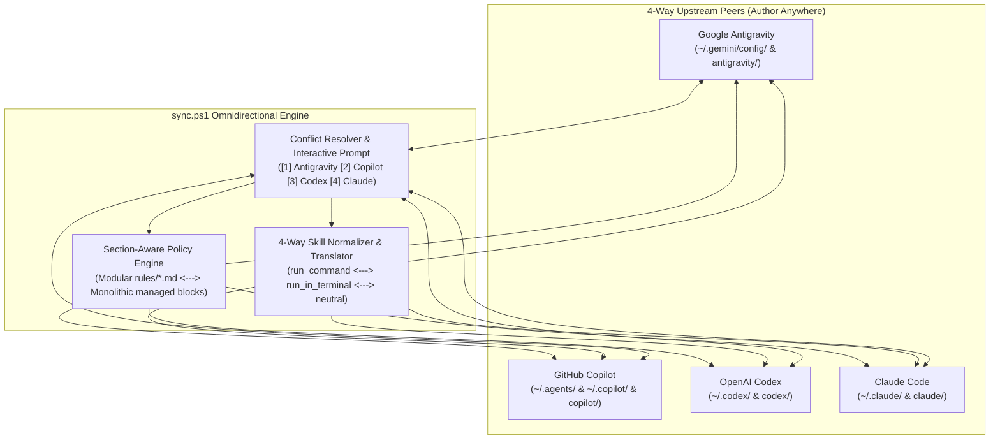

# Shared Agent Skills and Policies

This repository maintains reusable agent skills and unified global policies across four major AI developer harnesses: **Google Antigravity**, **GitHub Copilot**, **OpenAI Codex**, and **Claude Code**. Each tool has a dedicated top-level directory containing `skills/` and `policies/` that serve as version-controlled repository mirrors of machine-global configurations.

All synchronization workflows are driven by PowerShell 7 (`pwsh`) from the repository root via `copilot/skills/sync-skills-and-policies/scripts/sync.ps1`.

---

## Tool & Path Mapping

| Tool | Repository Skills | Repository Policies | Global Skills Path | Global Policy Path |
| :--- | :--- | :--- | :--- | :--- |
| **Antigravity** | [`antigravity/skills/`](antigravity/skills/) | [`antigravity/policies/`](antigravity/policies/) | `~/.gemini/config/skills/` | `~/.gemini/config/AGENTS.md` & `rules/*.md` |
| **GitHub Copilot** | [`copilot/skills/`](copilot/skills/) | [`copilot/policies/`](copilot/policies/) | `~/.agents/skills/` | `~/.copilot/copilot-instructions.md` |
| **Codex** | [`codex/skills/`](codex/skills/) | [`codex/policies/`](codex/policies/) | `~/.codex/skills/` | `~/.codex/AGENTS.md` |
| **Claude Code** | [`claude/skills/`](claude/skills/) | [`claude/policies/`](claude/policies/) | `~/.claude/skills/` | `~/.claude/CLAUDE.md` |

---

## Architecture & Synchronization Flow



---

## Policies

Antigravity uses a modular structure with standalone rule files in [`antigravity/policies/rules/`](antigravity/policies/rules/) and high-level agent instructions in [`antigravity/policies/AGENTS.md`](antigravity/policies/AGENTS.md). The sync engine compiles these modular rules into a single bounded block (`<!-- shared-agent-policy:start --> ... <!-- shared-agent-policy:end -->`) across Copilot, Codex, and Claude.

### Active Shared Policies

| Policy | Rule File | Purpose |
| :--- | :--- | :--- |
| **Manual Edits Take Precedence** | [`manual_edits.md`](antigravity/policies/rules/manual_edits.md) | User manual edits are authoritative; agents must never silently overwrite or revert user changes across turns. |
| **Cloud Deployment Policy** | [`cloud_deployments.md`](antigravity/policies/rules/cloud_deployments.md) | Strict prohibition on unrequested cloud deployments (`gcloud`, AWS, Azure, Terraform, Vercel) without user approval gates. |
| **Git Commit Policy** | [`git_commit_policy.md`](antigravity/policies/rules/git_commit_policy.md) | Strict prohibition on unrequested automatic commits; single-turn scope isolation (no commit mode carryover). |
| **Minimal Root Directory** | [`clean_root_directory.md`](antigravity/policies/rules/clean_root_directory.md) | Enforces clean repository roots; all application code, test files, scripts, and docs must live in designated folders. |
| **Clean Test Artifacts** | [`clean_test_artifacts.md`](antigravity/policies/rules/clean_test_artifacts.md) | Prohibits saving ephemeral tests or debug dumps in workspaces; directs ad-hoc test files to external scratch directories. |
| **GCP Resource & Cost Hygiene** | [`gcp_resource_cost_hygiene.md`](antigravity/policies/rules/gcp_resource_cost_hygiene.md) | Enforces automated version pruning in Secret Manager (free-tier guardrails) and retention cleanup policies in Artifact Registry. |
| **Workspace GitHub Sync** | [`workspace_github_sync.md`](antigravity/policies/rules/workspace_github_sync.md) | Standardized workflow for initializing Git, verifying `.gitignore`, and pushing workspaces to GitHub securely. |

---

## Skills

All eight shared skills are mirrored under each tool's `skills/` directory. Each skill contains a `SKILL.md` with YAML frontmatter (`name`, `description`) used by agent harnesses for on-demand discovery.

| Skill | Path | Purpose |
| :--- | :--- | :--- |
| **clone-github-repo** | [`copilot/skills/clone-github-repo/`](copilot/skills/clone-github-repo/SKILL.md) | Clone a Git or GitHub repository into the workspace, verify files, and inspect initial structure. |
| **cloud-deploy** | [`copilot/skills/cloud-deploy/`](copilot/skills/cloud-deploy/SKILL.md) | Prepare, validate, and deploy applications to cloud hosting (defaults to GCP Cloud Run / Cloud Build). |
| **create-github-repo** | [`copilot/skills/create-github-repo/`](copilot/skills/create-github-repo/SKILL.md) | Initialize Git, enforce .gitignore hygiene, create a remote GitHub repo, and push initial commits. |
| **generate-workspace-readme** | [`copilot/skills/generate-workspace-readme/`](copilot/skills/generate-workspace-readme/SKILL.md) | Intelligently create or refresh production-grade `README.md` documentation tailored to the codebase. |
| **safe-git-commit** | [`copilot/skills/safe-git-commit/`](copilot/skills/safe-git-commit/SKILL.md) | Review, audit working tree, enforce `.gitignore` hygiene, format conventional commits, and push cleanly. |
| **sequential-image-extractor** | [`copilot/skills/sequential-image-extractor/`](copilot/skills/sequential-image-extractor/SKILL.md) | Extract text, tables, and code from numbered sequence images and compile structured summaries. |
| **sync-skills-and-policies** | [`copilot/skills/sync-skills-and-policies/`](copilot/skills/sync-skills-and-policies/SKILL.md) | Audit and synchronize shared skills and global policies across all four agent harnesses. |
| **workspace-organizer** | [`copilot/skills/workspace-organizer/`](copilot/skills/workspace-organizer/SKILL.md) | Restructure workspaces, eliminate root clutter, maintain `.gitignore` hygiene, and enrich code comments. |

---

## Synchronization Workflow

Use the [sync-skills-and-policies](copilot/skills/sync-skills-and-policies/SKILL.md) script from the repository root:

```powershell
# 1. Audit drift across all skills and policies (Read-only)
pwsh -File copilot/skills/sync-skills-and-policies/scripts/sync.ps1 -Check

# 2. Synchronize both skills and policies (includes verification and auto-commit)
pwsh -File copilot/skills/sync-skills-and-policies/scripts/sync.ps1 -Sync

# 3. Audit policies only
pwsh -File copilot/skills/sync-skills-and-policies/scripts/sync.ps1 -Check -PoliciesOnly

# 4. Synchronize policies only
pwsh -File copilot/skills/sync-skills-and-policies/scripts/sync.ps1 -Sync -PoliciesOnly
```

### Onboarding a New Workstation

When cloning or pulling this repository onto a fresh workstation, deploy the repository policies directly into the four global harness directories:

```powershell
pwsh -File copilot/skills/sync-skills-and-policies/scripts/sync.ps1 -Sync -PoliciesOnly -PolicySource Repository
```

- `-PolicySource Repository` uses the repository policy snapshot as the source of truth, populating `~/.gemini/config/AGENTS.md`, `~/.gemini/config/rules/`, and the other three global policy files.
- Once policies are deployed, ensure any required skills are added to global registries before running full skill synchronization.

---

## Technical & Architectural Decisions

- **Antigravity as Modular Upstream & Policy Compiler**:
  - *Decision*: Author rules as individual markdown documents with `trigger: always_on` in `rules/*.md`, using `sync.ps1` to compile them into monolithic single-file instruction prompts (`copilot-instructions.md`, `AGENTS.md`, `CLAUDE.md`).
  - *Rationale*: Antigravity natively parses modular directory trees and triggers. Compiling down to single bounded blocks gives Copilot, Codex, and Claude identical policy enforcement without sacrificing clean modularity in the authoring repository.
  - *Trade-off*: Policies in downstream tools are generated blocks and should not be edited directly in downstream files; edits must originate in Antigravity or the repository mirror.

- **Explicit Single-Turn Commit & Push Scoping**:
  - *Decision*: Strict prohibition on persistent "commit mode" or unprompted automatic git operations across conversation turns.
  - *Rationale*: Prevents unintentional state mutation, premature commits of incomplete tasks, or leaking test/scratch files to remote repositories.

- **Automated Validation Gate in `sync.ps1`**:
  - *Decision*: When `-Sync` is executed, the script enforces pre-flight validation (no pre-existing staged files, valid `.gitignore`, clean whitespace diffs), verifies zero drift post-sync, and commits with standardized conventional message `chore(sync): synchronize shared skills and policies`.
  - *Rationale*: Guarantees that the repository mirrors and the active system files never silently diverge.
