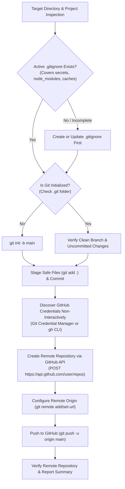

# Create GitHub Repository Skill

Use this skill whenever the user requests to publish a local workspace, directory, or project to a new GitHub repository, initialize remote version control, or push an existing local directory to GitHub.

---

## Safety & Hygiene Policies

> [!IMPORTANT]
> **DEFAULT REPOSITORY VISIBILITY IS STRICTLY PRIVATE**:
> Always create the remote repository as **private** (`private: true`) by default, unless the user explicitly and unambiguously specifies that it should be public.

> [!CAUTION]
> **MANDATORY .GITIGNORE HYGIENE BEFORE STAGING**:
> Never blindly run `git add .` without verifying that an active `.gitignore` file exists in the repository root and covers all critical security and build artifact patterns:
> 1. **Secrets, Tokens & Keys**: `.env`, `.env.*`, `*.pem`, `*.key`, `*.token`, `credentials.json`, `token.json`
> 2. **Dependencies & Virtual Environments**: `node_modules/`, `__pycache__/`, `*.py[cod]`, `.venv/`, `venv/`, `vendor/`, `target/`
> 3. **Build Outputs & Caches**: `dist/`, `build/`, `out/`, `.turbo/`, `.next/`, `*.egg-info/`, `.pytest_cache/`, `.mypy_cache/`
> 4. **System & Editor Settings**: `.DS_Store`, `Thumbs.db`, `desktop.ini`, `.idea/`, `.vscode/`
> 5. **Scratch & Test Dumps**: `scratch/`, `debug_*.py`, `tmp_*.py`, temporary log files

---

## Workflow Diagram



---

## Execution Methods

### Option A: Automated Execution via Helper Script (Recommended)

Run the included `scripts/create_repo.ps1` helper script using `run_in_terminal`. The script automatically handles `.gitignore` verification, credential discovery, repository creation, remote configuration, and pushing:

```powershell
pwsh -File .agents/skills/create-github-repo/scripts/create_repo.ps1 -WorkspacePath "<path>" -RepoName "<repo_name>" -Visibility "private" -Description "<description>"
```

#### Parameters:
- `-WorkspacePath`: Absolute path to the local directory (defaults to current working directory).
- `-RepoName`: Desired remote repository name (defaults to leaf folder name).
- `-Visibility`: `"private"` (default) or `"public"`.
- `-Description`: Optional repository description.
- `-InitialCommitMessage`: Commit message for uncommitted changes (defaults to `"Initial commit"`).
- `-DryRun`: Validates `.gitignore` and credentials without creating the remote repository or pushing.

---

### Option B: Step-by-Step Manual Execution

When executing step-by-step using `run_in_terminal` and `read_file`:

#### 1. Inspect Target Workspace & .gitignore
- Identify the target folder path. Do NOT use `cd`; specify `Cwd` explicitly in `run_in_terminal`.
- Use `read_file` or `list_dir` to confirm that `.gitignore` exists and excludes secrets, dependencies, build artifacts, and system files.
- If missing, write a proper `.gitignore` file before running any git commands.

#### 2. Local Git Initialization
- Check if `.git` exists using `run_in_terminal` (`git status`).
- If not initialized:
  ```powershell
  git init -b main
  ```
- Stage safe files and review staged status:
  ```powershell
  git add .
  git status --short
  ```
- Create initial commit if changes are staged:
  ```powershell
  git commit -m "Initial commit"
  ```

#### 3. Discover GitHub Credentials Non-Interactively
- On systems with Git Credential Manager configured:
  ```powershell
  $tempInput = [System.IO.Path]::GetTempFileName()
  $tempOutput = [System.IO.Path]::GetTempFileName()
  [System.IO.File]::WriteAllText($tempInput, "protocol=https`nhost=github.com`n`n", [System.Text.UTF8Encoding]::new($false))
  $proc = Start-Process -FilePath "git" -ArgumentList "credential", "fill" -NoNewWindow -PassThru `
      -RedirectStandardInput $tempInput -RedirectStandardOutput $tempOutput
  $proc.WaitForExit(10000)
  $cred = Get-Content -LiteralPath $tempOutput
  $token = ($cred | Where-Object { $_ -match '^password=' }) -replace '^password=', ''
  $owner = ($cred | Where-Object { $_ -match '^username=' }) -replace '^username=', ''
  Remove-Item -LiteralPath $tempInput, $tempOutput -Force -ErrorAction SilentlyContinue
  ```
- Alternatively, check if the GitHub CLI is available:
  ```powershell
  gh auth status
  $token = (gh auth token).Trim()
  $owner = (gh api user --jq .login).Trim()
  ```

#### 4. Create Remote Repository via GitHub API
- Determine repository name (defaulting to the folder name) and visibility (default `private`).
- Call the GitHub REST API:
  - **Method**: `POST https://api.github.com/user/repos`
  - **Headers**:
    - `Authorization: Bearer <token>`
    - `User-Agent: Antigravity`
    - `Accept: application/vnd.github+json`
  - **Body**: `{"name": "<repo_name>", "private": true, "description": "<description>"}`
- Or using GitHub CLI:
  ```powershell
  gh repo create <repo_name> --private
  ```

#### 5. Configure Remote Origin & Push
- Set remote origin:
  ```powershell
  git remote add origin https://github.com/<owner>/<repo_name>.git
  ```
- If origin already exists:
  ```powershell
  git remote set-url origin https://github.com/<owner>/<repo_name>.git
  ```
- Push to GitHub with upstream tracking:
  ```powershell
  git push -u origin main
  ```

#### 6. Verification & Reporting
- Verify remote repository contents via GitHub API (`GET /repos/<owner>/<repo>/contents`) or `git ls-remote origin`.
- Provide a summary to the user including:
  - Repository name and direct clickable link (`https://github.com/<owner>/<repo_name>`).
  - Visibility status (`private` / `public`).
  - Upstream branch name (`main`) and initial commit hash.
  - Landmark files verified in the remote repository (`README.md`, package manifests, configs).
